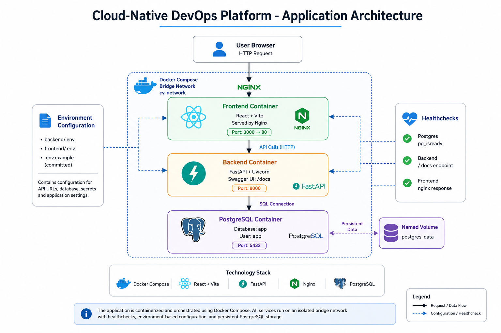
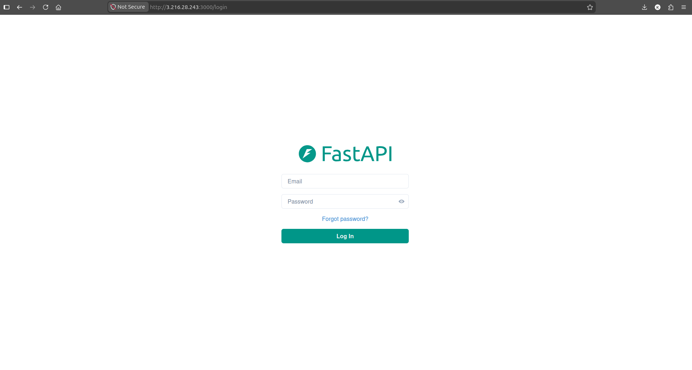
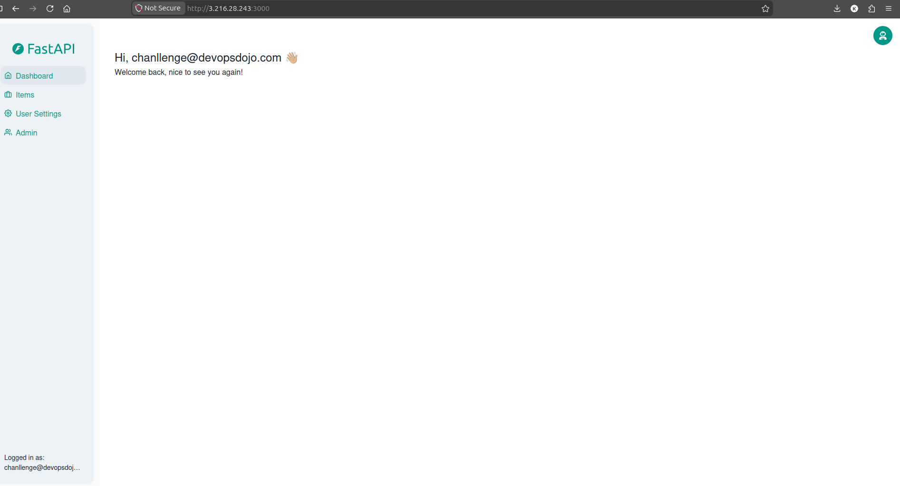
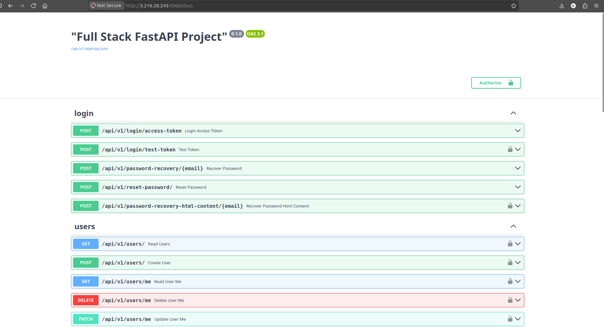
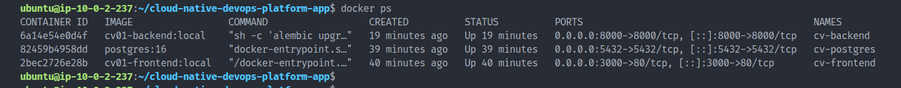
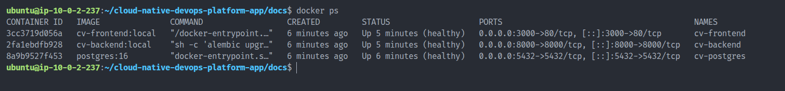

# Cloud-Native DevOps Platform - Application Repository

## Overview

This repository contains the application layer of the Cloud-Native DevOps Platform project.

The application consists of:

* React + Vite frontend
* FastAPI backend
* PostgreSQL database
* Docker containerization
* Docker Compose orchestration
* Container health checks
* Environment-based configuration

The goal of this repository is to provide a production-style application stack that can be deployed locally using Docker Compose and later deployed to Kubernetes.

---

## Architecture Diagram



---

## Technology Stack

| Component           | Technology      |
| ------------------- | --------------- |
| Frontend            | React + Vite    |
| Web Server          | Nginx           |
| Backend             | FastAPI         |
| Database            | PostgreSQL      |
| Containerization    | Docker          |
| Local Orchestration | Docker Compose  |
| Documentation       | Swagger/OpenAPI |

---

## Repository Structure

```text
cloud-native-devops-platform-app
│
├── frontend/
│   ├── Dockerfile
│   └── source code
│
├── backend/
│   ├── Dockerfile
│   └── source code
│
├── docs/
│   ├── manual-container-testing.md
│   ├── docker-compose-validation.md
│   ├── screenshots/
│   └── diagrams/
│
├── docker-compose.yaml
├── .env.example
├── README.md
└── .gitignore
```

---

## Manual Container Validation

Before introducing Docker Compose, each service was validated independently.

Validation performed:

* Frontend container build and execution
* Backend container build and execution
* PostgreSQL container deployment
* Backend connectivity to PostgreSQL
* Frontend connectivity to backend API
* User authentication validation
* Swagger UI validation

Detailed notes:

```text
docs/manual-container-testing.md
```

---

## Docker Compose Deployment

### Build and Start Services

```bash
docker compose up -d --build
```

### Verify Service Status

```bash
docker compose ps
```

### Access Frontend

```text
http://<SERVER_IP>:3000
```

### Access Backend Swagger UI

```text
http://<SERVER_IP>:8000/docs
```

---

## Health Checks

The Docker Compose stack includes health checks for:

### PostgreSQL

```text
pg_isready
```

### Backend

```text
/docs endpoint validation
```

### Frontend

```text
nginx response validation
```

These health checks ensure services are available before dependent services start.

---

## Validation Screenshots

### Frontend Login



### Frontend Dashboard



### Backend Swagger UI



### Manual Container Validation



### Docker Compose Health Checks



---

## Documentation

### Manual Container Testing

```text
docs/manual-container-testing.md
```

### Docker Compose Validation

```text
docs/docker-compose-validation.md
```

### Architecture Diagram

```text
docs/diagrams/app-architecture.drawio
docs/diagrams/app-architecture.png
```

---

## Future Enhancements

The next phase of this project will introduce:

* Kubernetes Deployments
* Kubernetes Services
* Ingress Controller
* ArgoCD GitOps
* Prometheus Monitoring
* Grafana Dashboards
* Loki Log Aggregation
* Alertmanager Notifications
* AWS Infrastructure Automation

---

## Project Status

Current Phase:

```text
Application Containerization & Docker Compose Orchestration
```

Status:

```text
Completed
```

## Secure Configuration

The FastAPI backend requires these environment variables:

| Variable | Purpose |
|---|---|
| `SECRET_KEY` | JWT signing and verification key |
| `POSTGRES_PASSWORD` | PostgreSQL database password |
| `FIRST_SUPERUSER_PASSWORD` | Initial administrator password |

All three values must be supplied through the deployment environment.

For local development, create `backend/.env` using `backend/.env.example`
as a template. The example file intentionally leaves credentials empty.

To generate a strong JWT signing key, run this command locally:

    python3 -c 'import secrets; print(secrets.token_urlsafe(48))'

Store the resulting key securely. Never commit it to Git.

The same JWT signing key must be used across all backend replicas and
application restarts.

For Kubernetes deployments, use a centrally managed secret, such as
AWS Secrets Manager integrated with External Secrets Operator.

Database and administrator passwords must also be supplied securely.

Do not store real credentials in Git repositories, container images,
documentation, or publicly accessible configuration files.

Before starting Docker Compose or Kubernetes workloads, ensure that
the required environment variables are available to the backend.

The example configuration files are templates, not production credentials.
