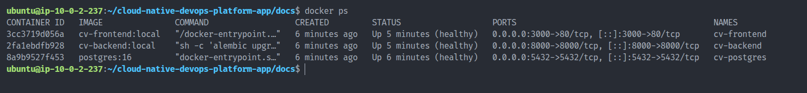
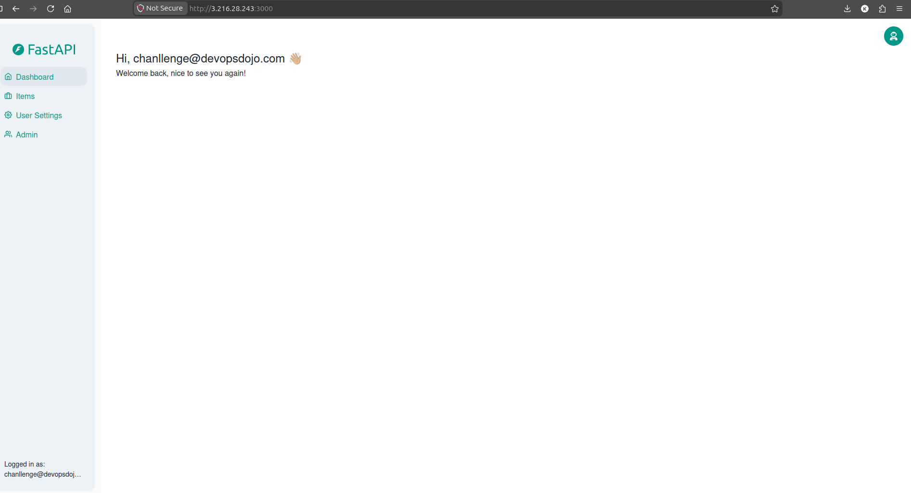
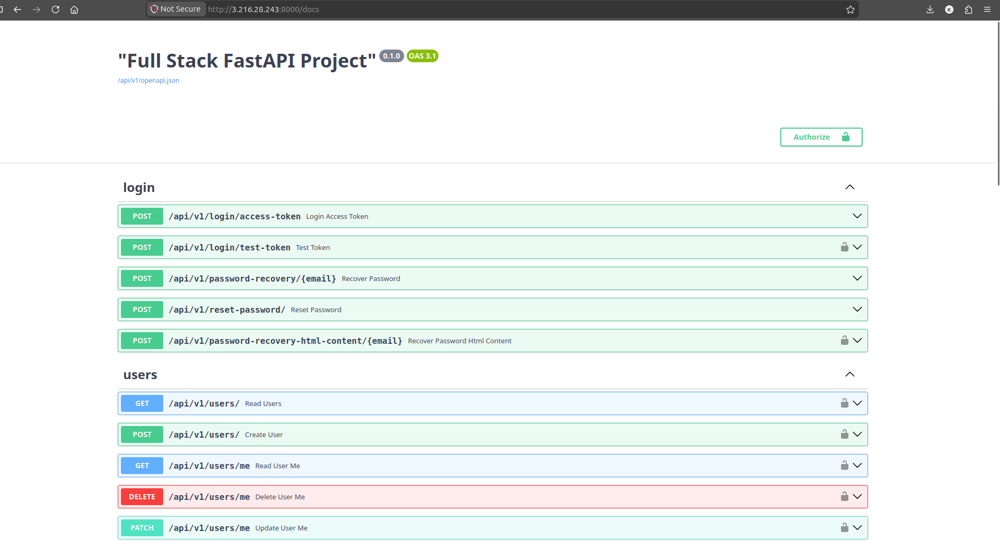

# Docker Compose Validation

## Objective

Validate that the complete application stack can be deployed using Docker Compose.

## Services

* Frontend (React + Nginx)
* Backend (FastAPI)
* PostgreSQL

## Deployment

Build and start services:

```bash
docker compose up -d --build
```

Verify service status:

```bash
docker compose ps
```

## Validation Results

### Container Health

All services reported healthy status.

### Frontend Access

Frontend login page was accessible.

### User Authentication

Successfully authenticated using the seeded application account.

### Backend API

Swagger UI was accessible at:

```text
http://<SERVER_IP>:8000/docs
```

### Database Connectivity

Backend successfully connected to PostgreSQL and application functionality was verified.

## Screenshots

### Healthy Containers



### Frontend Dashboard



### Swagger UI



## Outcome

Docker Compose successfully orchestrated the application stack and all services passed health checks.
